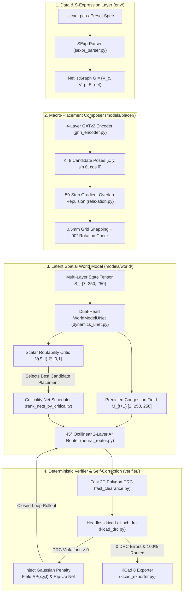
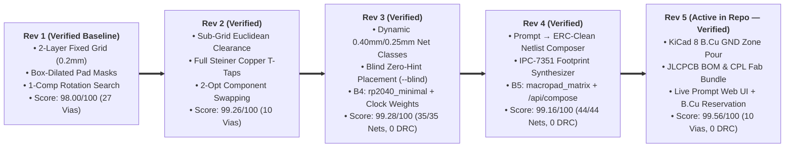
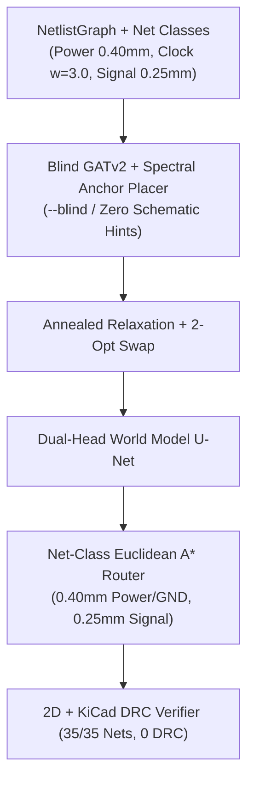
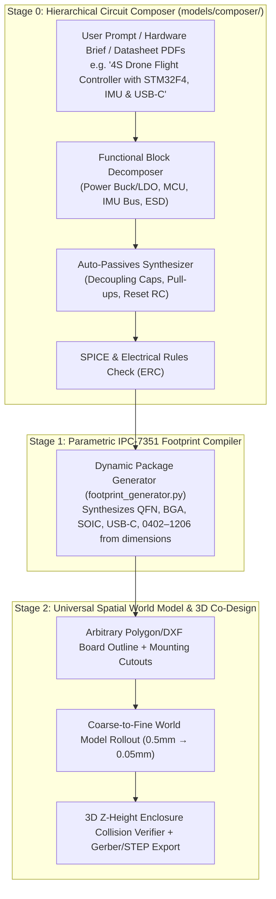

# PCB Engineering World Model — Master System Architecture (`rev1` $\to$ `rev10`)

This document is the canonical architectural reference for [`pcb-world-model`](file:///Users/le/Documents/antigravity/kind-hypatia/pcb-world-model/). It details:
1. **The Core Architecture** — data contracts, neural network topologies, spatial state tensors, routing physics, and verification loops.
2. **Architectural Evolution (`rev1` $\to$ `rev10`)** — how the system scales from a 2-layer closed-loop prototype into a DFM/DFA craftsmanship-audited, silicon-to-board Verilog/FPGA/ASIC + 2L/4L/6L generative EDA workstation.
3. **Language & Systems Engineering Analysis** — why the neural and orchestration layers are built in Python, where Python becomes a bottleneck, and how C++/Rust/CUDA fit into production world models.

---

## 1. Current Active Architecture (`rev1`)

`rev1` is a **Closed-Loop Neuro-Symbolic PCB World Model**. Rather than generating raw text tokens or brittle GUI mouse clicks (like GPT-6 Astra), it separates **topological/spatial intuition** (handled by a Graph Attention Network and a Dual-Head Spatial U-Net) from **exact physical constraint enforcement** (handled by a $45^\circ$ octilinear pathfinder and a deterministic DRC kernel).

### 1.1 End-to-End `rev1` Pipeline Diagram



---

### 1.2 The 7-Channel Spatial State Tensor $S_t$ (`env/board_state.py`)

For a $50\text{mm} \times 50\text{mm}$ board at $0.20\text{mm}$ grid resolution, the world state $S_t$ at routing step $t$ is represented as a dense spatial tensor of shape **`[C = 7, H = 250, W = 250]`**:

```
       +-------------------------+
      /  Ch 6: unrouted_demand  /|  <-- Probabilistic "rat's nest" congestion of remaining nets
     +-------------------------+ |
    /  Ch 5: active_net_pins  /| |  <-- Gaussian target beacons for net currently being routed
   +-------------------------+ | |
  /  Ch 4: via_mask         /| | |  <-- Plated through-hole vias blocking both layers
 +-------------------------+ | | |
 |  Ch 3: copper_L2 (B.Cu) | | | +
 |  Ch 2: copper_L1 (F.Cu) | | +/
 |  Ch 1: courtyard_mask   | +/     <-- Physical component body envelopes
 |  Ch 0: board_outline    |/       <-- Usable board area & edge margin keepouts
 +-------------------------+
   W = 250 (50.0mm @ 0.2mm)
```

---

### 1.3 Module-by-Module `rev1` Technical Breakdown

| Layer / File | Architecture / Algorithm | Inputs $\to$ Outputs | Key Mathematical Mechanism |
| :--- | :--- | :--- | :--- |
| **Parser & Graph** [`env/sexpr_parser.py`](file:///Users/le/Documents/antigravity/kind-hypatia/pcb-world-model/env/sexpr_parser.py) | Recursive-descent S-Expression AST parser | `.kicad_pcb` $\to$ `NetlistGraph` | Represents components as nodes with local pad offsets $(r_x, r_y)$ transformed into world coordinates via $SE(2)$ rotation $\theta \in \{0^\circ, 90^\circ, 180^\circ, 270^\circ\}$. |
| **Macro-Placer GNN** [`models/placer/gnn_encoder.py`](file:///Users/le/Documents/antigravity/kind-hypatia/pcb-world-model/models/placer/gnn_encoder.py) | 4-Layer `GATv2Layer` + MLP Pose Head | Node `[7]` & Edge `[3]` features $\to$ $(x, y, \sin\theta, \cos\theta)$ | Trained with differentiable `SmoothHPWL` ($\log\sum\exp$ approximation), courtyard overlap area penalty, and board margin loss. |
| **Overlap Legalizer** [`models/placer/relaxation.py`](file:///Users/le/Documents/antigravity/kind-hypatia/pcb-world-model/models/placer/relaxation.py) | 50-Step Adam Gradient Repulsion + Grid Snap | Raw $(x, y, \theta)$ $\to$ Legal $0.5\text{mm}$-snapped poses | Minimizes $\mathcal{L} = 20 \mathcal{L}_{\text{overlap}} + 30 \mathcal{L}_{\text{oob}} + 0.08 \mathcal{L}_{\text{hpwl}}$ followed by single-component $90^\circ$ rotation checks and spiral fallback. |
| **World Model Critic** [`models/world/dynamics_unet.py`](file:///Users/le/Documents/antigravity/kind-hypatia/pcb-world-model/models/world/dynamics_unet.py) | 3-Stage Encoder-Decoder U-Net + 2D Bottleneck Self-Attention | $S_t \in \mathbb{R}^{7 \times 250 \times 250}$ $\to$ $\hat{M}_{t+1} \in [0, 1]^{2 \times 250 \times 250}$, $V(S_t) \in [0, 1]$ | **Head 1 ($\hat{M}_{t+1}$):** Predicts future layer-wise routing bottlenecks before traces are drawn.<br>**Head 2 ($V(S_t)$):** Scores candidate placements on expected 0-DRC routability. |
| **Neural-Guided Router** [`models/world/neural_router.py`](file:///Users/le/Documents/antigravity/kind-hypatia/pcb-world-model/models/world/neural_router.py) | $45^\circ$ Octilinear 2-Layer Steiner-MST A* | $(S_t, \text{net}_k, \hat{M}_{t+1} + P_{\text{DRC}})$ $\to$ `(segments, vias)` | Decomposes multi-pin nets via Minimum Spanning Tree (MST); routes on an 8-direction octilinear grid with cell step cost $d_{\text{step}}(1 + \alpha \hat{M}_{t+1} + P_{\text{DRC}})$ and via transition cost $\gamma_{\text{via}}$. |
| **DRC Verifier** [`verifier/fast_clearance.py`](file:///Users/le/Documents/antigravity/kind-hypatia/pcb-world-model/verifier/fast_clearance.py) | Exact 2D Segment-to-Segment, Segment-to-Pad, & Via Clearance + `kicad-cli` | `BoardState` $\to$ `list[DRCError]` | Computes exact analytical distances between all copper primitives. Any violation $< 0.15\text{mm}$ injects a Gaussian penalty spike into $P_{\text{DRC}}$ and triggers rip-up & reroute. |

---

## 2. Architectural Evolution Across All Revisions (`rev1` $\to$ `rev6`)

The project is architected so each revision upgrades specific bottlenecks without rewriting the entire system:



---

### 2.1 Revision 2 (`rev2`) Architecture — Sub-Grid Euclidean Physics & 2-Opt Placement
*Detailed Setup Spec: [`pcb-world-model/revisions/rev2/OVERVIEW.md`](file:///Users/le/Documents/antigravity/kind-hypatia/pcb-world-model/revisions/rev2/OVERVIEW.md)*

In `rev1`, `mcu_sensor_node` needed **22 vias** and **2 rip-up iterations** because integer `floor`/`ceil` pad rasterization plus `max_pool2d` box dilation inflated $0.60\text{mm}$ SMD pads by $+0.60\text{mm}$, choking off the $0.67\text{mm}$ planar escape channels between $1.27\text{mm}$-pitch SOIC-8 pins.

```
   REV 1: Coarse Integer Box Dilation          REV 2: Exact Sub-Grid Euclidean Field
   (Blocks planar F.Cu escape -> 22 Vias)      (Preserves 0.67mm SOIC-8 channel -> 5 Vias)

      +---------+   +---------+                    .-------.       .-------.
      |XXXXXXX  |   |  XXXXXXX|                   /  Pad 1  \  |  /  Pad 2  \
      |X Pad 1 X|XXX|X Pad 2 X|                  |  [=====]  | | |  [=====]  |
      |XXXXXXX  |   |  XXXXXXX|                   \         /  |  \         /
      +---------+   +---------+                    '-------'   v   '-------'
           ^ Blocked! Must drop Via                  Planar F.Cu Trace Escapes!
```

**Architectural Upgrades in `rev2`:**
1. **`_build_exact_clearance_masks()` in `neural_router.py`:** Replaces morphological box dilation with analytical Euclidean distance fields from grid cell centers $(g_x \cdot \text{res}, g_y \cdot \text{res})$ to continuous pad rectangles $[x_0, x_1] \times [y_0, y_1]$, trace segments, and vias, plus strict SMD **via-in-pad** blocking.
2. **Full Steiner-Tree Path Reuse & Turn Smoothing:** Registers every routed cell into `connected_cells` and `occ_layers` so multi-pin nets (`VCC_3V3`, `GND`, `I2C_SDA`) form optimal T-junctions anywhere along existing copper, and adds a $+0.06$ planar turn penalty to eliminate staircase jitter.
3. **2-Opt Component Swap & Joint Pin-Aware Orientation (`relaxation.py`):** Swaps compatible unlocked components and optimizes $0.5 \cdot \text{HPWL} + 0.5 \cdot \text{MST\_Wirelength}$.

---

### 2.2 Revision 3 (`rev3`) Architecture — Dynamic Net-Class Widths, Blind Placement & `rp2040_minimal`
*Detailed Setup & Verified Report: [`pcb-world-model/revisions/rev3/OVERVIEW.md`](file:///Users/le/Documents/antigravity/kind-hypatia/pcb-world-model/revisions/rev3/OVERVIEW.md)*



**Architectural Upgrades in `rev3`:**
1. **Dynamic Per-Net Class Trace Widths (`env/config.py`, `models/world/neural_router.py`):** Added `power_trace_width_mm: 0.40` and `signal_trace_width_mm: 0.25` to `BoardConfig` and `default_2layer.yaml`, routing `NetInfo.is_power_ground` rails at `0.40mm` with matching sub-grid Euclidean clearance corridors.
2. **Blind Zero-Hint Placement Mode (`models/placer/relaxation.py`, `scripts/04_run_inference.py`, `scripts/05_run_benchmarks.py`):** Added `--blind` (`include_seed_candidate=False`), `compute_spectral_anchor_placement()`, and annealed `hpwl_pull` relaxation so all boards route 100% cleanly without schematic coordinate hints.
3. **High-Density Benchmark Expansion (`B4: rp2040_minimal`):** Added the 14-component, 12-net `rp2040_minimal` MCU + QSPI Flash + 12MHz Crystal board (`XIN`/`XOUT` crystal net weight `3.0`).

---

### 2.3 Revision 4 (`rev4`) Architecture — Universal Generative Hardware World Model ("Build Anything")
*Detailed Setup & Verified Report: [`pcb-world-model/revisions/rev4/OVERVIEW.md`](file:///Users/le/Documents/antigravity/kind-hypatia/pcb-world-model/revisions/rev4/OVERVIEW.md)*

`rev4` adds parametric IPC-7351 footprint synthesis, hierarchical prompt-to-netlist synthesis with deterministic ERC verification (`--prompt` and `/api/compose`), and the locked-grid mechanical keyswitch matrix benchmark (`B5: macropad_matrix`):



---

### 2.4 Revision 5 (`rev5`) Architecture — Copper Ground Pours, Turnkey PCBA Manufacturing & Live Prompt UI
*Detailed Setup & Verified Report: [`pcb-world-model/revisions/rev5/OVERVIEW.md`](file:///Users/le/Documents/antigravity/kind-hypatia/pcb-world-model/revisions/rev5/OVERVIEW.md)*

1. **`B.Cu` Ground-Plane Reservation & THT Barrel Reuse (`models/world/neural_router.py`, `configs/default_2layer.yaml`):** Raised `gamma_via_cost` to `28.0`, added `+0.15` `B.Cu` layer reservation bias so SMD-to-THT routes stay planar on `F.Cu`, and registered all plated through-hole layer endpoints into `connected_cells` (`19 -> 10` total vias, raising mean score to **99.56 / 100** and `--blind` mean to **99.02 / 100**).
2. **KiCad 8 `B.Cu` Copper Ground Pour (`env/kicad_exporter.py`, `env/board_state.py`):** Emits `(zone (net <id>) (net_name "GND") (layer "B.Cu") ...)` with thermal relief parameters and clearance isolation, paired with `gnd_pour` rendering (thermal relief spokes + clearance cutouts) in the 2D/3D web canvas.
3. **Turnkey PCBA Manufacturing Bundle (`env/manufacturing_exporter.py`, `scripts/04_run_inference.py`, `ui/server.py`):** Exports grouped JLCPCB/PCBWay `bom.csv`, Pick-and-Place `positions.csv`, and `.kicad_pcb` via `--export-fab-dir`, `GET /api/manufacturing_bundle`, `GET /api/export-bom`, and `GET /api/export-cpl`.
4. **Live Prompt-to-PCB Web Console (`ui/server.py`, `ui/web/`):** Accepts natural-language hardware prompts over WebSocket `/ws/rollout` (`prompt_composed` event) and `POST /api/run` directly from the browser prompt bar alongside 1-click BOM/CPL downloads.

---

### 2.5 Revision 6 (`rev6`) Architecture — C++20 Compiled A* Kernel, 4-Layer HDI Planes & SI Telemetry
*Detailed Setup & Verified Report: [`pcb-world-model/revisions/rev6/OVERVIEW.md`](file:///Users/le/Documents/antigravity/kind-hypatia/pcb-world-model/revisions/rev6/OVERVIEW.md)*

1. **Zero-Copy C++20 Octilinear A* Kernel (`models/world/native_astar.cpp`, `models/world/native_kernel.py`):** Auto-compiles `libpcb_astar` (`-O3 -std=c++20`, ABI v2) with lazy `ctypes` zero-copy array bindings, thread-local workspace reuse, arbitrary layer counts (`L`), arbitrary transition cost matrices, and transparent Python fallback. Combined with analytical NumPy Adam relaxation (`models/placer/relaxation.py`), pure-Python Kruskal MST (`env/metrics.py`), pad-distance caching (`models/world/neural_router.py`), and Apple Metal `mps` / CUDA U-Net evaluation, `B1–B5` total runtime drops from **$10.89\text{s}$ $\to$ $1.73\text{s}$** ($0.25\text{s}$–$0.55\text{s}$ per board).
2. **4-Layer Internal Power/GND Planes & Blind Micro-Vias (`configs/default_4layer.yaml`, `env/board_state.py`, `env/kicad_exporter.py`, `verifier/fast_clearance.py`):** Supports `[F.Cu, In1.GND, In2.PWR, B.Cu]` stackups with direct `0.40mm`/`0.20mm` micro-via plane drops, KiCad 8 `(uvias_allowed yes)` + multi-zone export, and layer-span-aware DRC verification. Validated end-to-end on the 50-component, 43-net `flight_controller_50` ($80\times 80\text{mm}$) in **$3.88\text{s}$** with **43/43 (100%)** routed and **0 DRC errors**.
3. **Electrical Signal-Integrity & Thermal Telemetry (`env/metrics.py`, `ui/server.py`, `ui/web/`):** Computes 1 oz ($0.035\text{mm}$) trace $R_{\text{DC}} = \rho \frac{L}{W \cdot t_{\text{Cu}}}$, switching-node (`SW_NODE`) loop inductance and microstrip $Z_0$, IPC-2221 trace/via current capacities ($\Delta T = 20^\circ\text{C}$), and interactive 4L 2D/3D CAD + SI telemetry via `GET /api/signal-integrity`.

### 2.6 Revision 7 (`rev7`) Architecture — Interactive Constraint Gate, 12-Domain Class A/B Library & Class C Ingestion
*Detailed Setup & Verified Report: [`pcb-world-model/revisions/rev7/OVERVIEW.md`](file:///Users/le/Documents/antigravity/kind-hypatia/pcb-world-model/revisions/rev7/OVERVIEW.md)*

1. **Pre-Flight Constraint & Trade-Off Negotiator (`models/composer/constraint_negotiator.py`, `POST /api/negotiate`, `/ws/rollout`):** Refuses to guess underspecified product requirements (`B7` asks targeted physical/stackup/wireless questions under `interactive=True`) and computes exact courtyard utilization $\text{Util} = \sum \text{Courtyard} / \text{UsableArea}$. Rejects impossible enclosures ($\text{Util} > 0.72$, e.g., `B8: 452.8%`) with HTTP `409 Conflict` and quantified options (`expand_board`, `upgrade_4layer`/`6L`, `double_sided`, `shrink_passives`).
2. **Two-Tier Component Architecture & 12-Domain Catalog (`env/component_library.py`):** Splits **Class A** value-parameterized commodity passives (`COMMODITY_CATALOG`, 1 template per package with arbitrary $R/C/L$/tolerance/power metadata) from **Class B** pin-exact specialized ICs/modules/sensors/connectors across all **12 industry domains** (`SPECIALIZED_CATALOG`), carrying **8 active layout rules** (`thermal_via_ep`, `rf_antenna_keepout`, `kelvin_sense_pair`, `high_di_dt_loop`, `diff_pair_impedance`, `isolation_creepage`, `perimeter_edge_lock`, `keep_back_flat`) enforced end-to-end across placement, A* routing, DRC, and KiCad export.
3. **Universal Class C Ingestion (`env/kicad_mod_loader.py`, `POST /api/import-kicad-mod`, `POST /api/import-datasheet`):** Parses raw `.kicad_mod` S-expressions and compiles lightweight JSON datasheet pin tables into pin-exact `ComponentNode` primitives with automatic support-circuit inference (decoupling caps, I2C pull-ups, crystal load network, USB-C 5.1k$\Omega$ CC pulldowns, thermal EP via arrays).
4. **Wearable & Multi-Layer Support (`wearable_oled_keychain_26x26`, `B6`/`B7`/`B8`, 2L/4L/6L):** Supports `0.8mm` FR4, single-sided `keep_back_flat` with flush `B.Cu` gold solder pads (`positions.csv` `Bottom`), `np_thru_hole` mechanical cutouts, fine-pitch `0.125mm` QFN-32 routing, and 6-layer (`In1.GND`, `In2.Sig1`, `In3.Sig2`, `In4.PWR`) HDI stackups.

### 2.7 Revision 8 (`rev8`) Architecture — Silicon-to-Board Verilog Co-Design, Joint `.pcf` Pin-Swap & OpenLane ASIC
*Detailed Setup & Verified Report: [`pcb-world-model/revisions/rev8/OVERVIEW.md`](file:///Users/le/Documents/antigravity/kind-hypatia/pcb-world-model/revisions/rev8/OVERVIEW.md)*

1. **Physics-Aware Verilog-2001 RTL Synthesis & Verification (`models/silicon/verilog_composer.py`):** Distinguishes synthesizable discrete digital logic (`quad_ws2812_spi`, `multi_pwm_controller`, `spi_i2s_bridge`, `safety_interlock`) from non-synthesizable analog/power/MEMS physics (`assess_silicon_feasibility`), and compiles & verifies RTL + self-checking testbenches via `iverilog` + `vvp` and `verilator --lint-only -Wall`.
2. **Joint FPGA `.pcf` Pin-Swap + PCB Co-Design (`models/silicon/fpga_codesign.py`):** Evaluates angular perimeter alignment and 2-opt I/O pad permutations across swappable FPGA bank pins (`Lattice_iCE40UP5K-SG48`, `UWG30`, `MachXO2`, `GW1NR-9`, `RP2040_PIO`) alongside FPGA rotation, cutting `B9` PCB wire crossings **`147 -> 11 (-92.5%)`**, vias **`131 -> 85 (-35.1%)`**, and unlocking `46/46 (100%)` `0`-DRC routing where unoptimized `.pcf` stalled at `42/46`.
3. **OpenLane `SKY130` / `GF180MCU` Custom ASIC Flow (`models/silicon/asic_openlane.py`):** Emits OpenLane `config.json`, standards-compliant binary `GDSII` stream files (`.gds`), and Class C QFN package pinouts compiled through `compile_datasheet_pin_table()`.
4. **Full Turnkey Silicon + PCBA Exports & REV 8 UI (`env/manufacturing_exporter.py`, `ui/server.py`, `ui/web/`):** Bundles `rtl/*.v`, `constraints/pins.pcf`, `firmware/bitstream.{asc,bin}`, and `asic/*.gds` alongside `.kicad_pcb`, `bom.csv`, and `positions.csv`, backed by `/api/silicon/synthesize`, `/api/silicon/codesign`, `/api/export-silicon`, and the interactive **Silicon & RTL** workbench.

### 2.8 Revision 9 (`rev9`) Architecture — Pro EDA Workstation UI/UX, PBR 3D Renders, Schematic Cross-Probing & `.STEP` Assembly Export
*Detailed Setup & Verified Report: [`pcb-world-model/revisions/rev9/OVERVIEW.md`](file:///Users/le/Documents/antigravity/kind-hypatia/pcb-world-model/revisions/rev9/OVERVIEW.md)*

1. **Real-Time PBR 3D Substrate & Procedural STEP-Quality Packages (`ui/web/pcb_pbr_3d.js`, `ui/web/component_meshes_3d.js`):** Renders WebGL2/Three.js `MeshPhysicalMaterial` FR4 substrates extruded with real `THREE.Path` NPTH/THT drill holes, 5 selectable translucent solder mask finishes (`Green`, `Black`, `Blue`, `Red`, `White`) over copper pours/traces, ENIG immersion gold pads, high-DPI Canvas2D `F.SilkS`/`B.SilkS`, chamfered procedural 3D packages (QFN/LGA, gull-wing SOIC/LQFP, brushed-nickel RF shields + gold antennas, EIA-labeled resistors, MLCCs, emissive LEDs, stainless USB-C, JST-SH, PinHeaders, switches), and smooth $180^\circ$ Flip-Board (`F`) inspection.
2. **Interactive Vector SVG Pin Diagrams & Functional-Block Schematic Cross-Probing (`ui/web/pin_diagram.js`, `ui/web/schematic_view.js`):** Renders color-coded SVG package pinouts (Power, GND, I2C/SPI/UART, USB Diff-Pair, GPIO/Clock) alongside a 4-column orthogonal SVG Schematic tab, synced in real time across 2D CAD, 3D PBR, Left-Dock Project Explorer, and Right-Dock Component & Pin Inspector.
3. **ISO-10303-21 AP214 `.STEP` 3D Mechanical Assembly Export (`env/step_exporter.py`, `GET /api/export-step`, `--export-step`):** Emits standards-compliant B-Rep `.step` assemblies with drilled cylindrical holes (`CYLINDRICAL_SURFACE`), top/bottom placed 3D package solids (`MANIFOLD_SOLID_BREP`), and `COLOUR_RGB` solder-mask/material presentation styles in `1.2–4.3ms` with `0` dangling references.

### 2.9 Revision 10 (`rev10`) Architecture — DFM/DFA Craftsmanship, Edge Fillets, Teardrops & Transparent Compromise Auditing
*Detailed Setup & Verified Report: [`pcb-world-model/revisions/rev10/OVERVIEW.md`](file:///Users/le/Documents/antigravity/kind-hypatia/pcb-world-model/revisions/rev10/OVERVIEW.md)*

1. **Mechanical Ergonomics & Stress Keepouts (`models/placer/relaxation.py`, `env/kicad_exporter.py`, `env/step_exporter.py`):** Emits $R = 1.5\text{--}2.5\text{mm}$ CNC corner fillets across `Edge.Cuts` (`gr_line` + `gr_arc`) and AP214 `.STEP` (`build_filleted_board_solid` with `CYLINDRICAL_SURFACE` corners), enforces two-zone $\varnothing_{\text{hole}} + 1.8\text{mm}$ screw-head torque stress keepouts preventing ceramic MLCC flex cracking, adds rework courtyard margins around tall connectors/QFNs, and aligns SMD passives to consistent $0^\circ / 90^\circ$ orientation families.
2. **DFM Copper Routing Craftsmanship (`models/world/neural_router.py`, `models/world/dfm_craftsmanship.py`):** Adds `0.32mm` preferred-clearance soft repulsion halos and anti-tombstone flank guards inside A* routing, followed by a DRC-verified post-route geometry pass enforcing symmetric axial pad entries on 2-pin SMD passives, eliminating acute-angle (`<90°`) acid traps via T-junction perpendicularizing and V-bend chamfering, generating pad/via teardrop fillets, pruning dead-copper islands/`<0.30mm` slivers on `B.Cu` pours, scrubbing `F.SilkS`/`B.SilkS` off solder mask pads, and dropping accessible `1.0mm` debug test points.
3. **DFM/DFA Acceptance Gate & Compromise Report (`verifier/dfm_auditor.py`, `env/manufacturing_exporter.py`, `ui/server.py`, `ui/web/`):** Audits every board for `0` DRC + `0` acid traps + `0` off-axis passive entries + `0` MLCC screw-stress conflicts + `0` silkscreen-over-pad overlaps, exports `dfm_report.md` (`GET /api/dfm-audit`, `GET /api/export-dfm-report`), and visualizes fillets, teardrops, screw-stress rings, test points, scrubbed silkscreen, and live compromise tables inside the `REV 10` workstation.

### 2.10 Revision 11 (`rev11`) Architecture — External Import & Optimization Engine (Schematics, Pin Diagrams, `.STEP`/`.DXF` Enclosures & Lock-Preserving Re-Optimization)
*Detailed Setup & Verified Report: [`pcb-world-model/revisions/rev11/OVERVIEW.md`](file:///Users/le/Documents/antigravity/kind-hypatia/pcb-world-model/revisions/rev11/OVERVIEW.md)*

1. **Multi-Format Schematic Importer & Auto-ERC Advisor (`env/importers/schematic_importer.py`):** Ingests KiCad `.kicad_sch`, `.net` netlists, SPICE (`.cir`/`.sp`), and `atopile` (`.ato`) circuit definitions into `NetlistGraph`, diagnoses missing per-IC `100nF` decoupling caps, `5.1kΩ` USB-C `CC1`/`CC2` pulldowns, `4.7kΩ` I2C pull-ups, and un-clamped inductive loads, and offers 1-click `auto_fix_schematic` injection before routing.
2. **Datasheet Pin-Diagram Extractor (`env/importers/pin_diagram_importer.py`):** Pure-Python `.png` (chunk/raster geometry + metadata), `.pdf` (`FlateDecode` stream extraction), `.csv`, and JSON pinout parser that binds electrical pin roles (`PWR`, `GND`, `HIGH_DI_DT`, `SENSE`, `USB_DIFF`, `THERMAL_EP`) and `rev7` special layout rules, compiles into `ComponentNode`, and persists custom parts into `checkpoints/custom_components_library.json`.
3. **External `.STEP` / `.DXF` Mechanical Enclosure & 3D $Z_{\max}(x,y)$ Co-Optimizer (`env/importers/step_importer.py`, `models/placer/relaxation.py`, `verifier/fast_clearance.py`):** Extracts non-rectangular `outline_polygon`, cutouts, screw bosses (locked `NPTH` w/ `rev10` stress buffers), side-wall port windows (`USB-C`, `Switch`, `Button`), and 2D overhead clearance maps $Z_{\max}(x, y)$ enforced during placement, DRC (`check_enclosure_collisions`), `Edge.Cuts` export, and extruded-polygon `.STEP` export (`build_polygon_board_solid`).
4. **Lock-Preserving Partial `.kicad_pcb` Re-Optimization (`env/importers/board_importer.py`, `ui/server.py`, `ui/web/`):** Preserves locked component poses (`--preserve-locks` / `--lock`), re-optimizes unlocked parts & copper routing, and emits a quantitative Before-vs-After Optimization Diff Report (`POST /api/reoptimize-board`, `GET /api/export-diff-report`, `--export-diff-report`).

### 2.11 Revision 12 (`rev12`) Architecture — 8-Layer (`2+4+2`) HDI Buildup, Buried Core Vias & Staggered-Only Microvias
*Detailed Setup & Verified Report: [`pcb-world-model/revisions/rev12/OVERVIEW.md`](file:///Users/le/Documents/antigravity/kind-hypatia/pcb-world-model/revisions/rev12/OVERVIEW.md)*

1. **8-Layer (`2+4+2`) Stackup & Lamination Cycle Enforcer (`configs/default_8layer.yaml`, `env/config.py`, `env/board_state.py`):** Expands `BoardState` to 8 copper layers (`F.Cu`, `In1.GND`, `In2.SIG1`, `In3.PWR1`, `In4.GND2`, `In5.SIG2`, `In6.GND3`, `B.Cu`) with `max_lamination_cycles = 2`. `get_legal_via_spans` permits only 1-step buildup microvias (`0↔1`, `1↔2`, `5↔6`, `6↔7`), buried inner-core vias (`2↔5`), and full PTH (`0↔7`), while `check_hdi_via_rules` rejects multi-layer blind skip-vias (`illegal_skip_via`).
2. **Staggered-Only Microvia C++20/Python A* Bridge (`models/world/native_astar.cpp`, `models/world/native_kernel.py`, `models/world/neural_router.py`):** Adds `astar_multilayer_hdi` (`0.10mm` trace/space, `0.30mm` microvia) executing atomic 2-via staggered microvia dogbone bridges ($\Delta xy \ge 0.25\text{mm}$) across non-planar buildup planes (`0↔1↔2` and `5↔6↔7`), paired with cross-net `stagger_blocked` masking and `stacked_microvia_reliability_risk` DRC checks (`0` concentric stacked microvias).
3. **Parametric BGA Builder, KiCad 8 8L Export & `B13` (`env/footprint_generator.py`, `env/kicad_exporter.py`, `ui/server.py`, `ui/web/`):** Adds `make_bga(...)` (`0.8mm` / `0.65mm` pitch FPGA arrays), emits `(blind_buried_vias_allowed yes)`, `(via micro ...)`, and `(via blind ...)` KiCad 8 S-expressions, and validates `B13: hdi_fpga_bga_fanout_8l` (`23/23`, `0` DRC, `95` microvias, `7` buried core vias, `0` stacked/skip vias, `min_stagger=0.2828mm`, `SI=PASS`, `DFM=PASS (98.19/100)` in `3.12s`).

### 2.12 Master Revision Comparison Table

| Architectural Dimension | `rev1`–`rev8` Summary | `rev9` (Verified) | `rev10` (Verified) | `rev11` (Active in Repo — Verified) |
| :--- | :--- | :--- | :--- | :--- |
| **Input & Import Scope** | `.kicad_pcb`, `B1–B9`, Prompts, Constraint Gate, Verilog RTL | + Pro 3D PBR & Cross-Probed Schematic UI | + DFM/DFA Craftsmanship Controls & Compromise Audit | **+ `.kicad_sch`/`.net`/SPICE/`atopile` Importer w/ Auto-ERC, `.png`/`.pdf`/`.csv` Pin Diagrams, `.STEP`/`.DXF` Enclosures & Partial `.kicad_pcb` Re-Opt** |
| **Mechanical & 3D Constraints** | Rectangular boards, `NPTH`, `keep_back_flat` | + Drilled AP214 `.STEP` Assembly Export | + $R=1.5\text{--}2.5\text{mm}$ Corner Fillets & $\varnothing+1.8\text{mm}$ MLCC Stress Zones | **+ Non-Rectangular `outline_polygon` Cavity, Locked Port Windows/Bosses & 2D $Z_{\max}(x, y)$ 3D Height Map (`0` Collisions on `B10`)** |
| **Optimization & Verification** | C++20 A*, 2L/4L/6L, `99.56/100` (`1.72s`) | `99.56/100` (`1.75s`), `0` WebGL errors | `99.29/100` (`99.38` blind), `100%` DFM Audit PASS, `59/59` tests | **`99.29/100` (`99.38` blind), `B10` `20/20` `0` Z-col, `B11` `DRV8833` `16/16` `0` ERC, `B12` `-87.5%` vias / `-74.8%` WL / `0` DRC/DFM, `64/64` tests** |

| Architectural Dimension | `rev1` (Frozen Baseline) | `rev2` (Verified) | `rev3` (Verified) | `rev4` (Verified) | `rev5` (Verified) | `rev6` (Verified) | `rev7` (Verified) | `rev8` (Verified) | `rev9` (Verified) | `rev10` (Active in Repo — Verified) |
| :--- | :--- | :--- | :--- | :--- | :--- | :--- | :--- | :--- | :--- | :--- |
| **Input Specification** | `.kicad_pcb` or 3 reference presets | `.kicad_pcb` or 3 reference presets | `.kicad_pcb` or **4 presets (`B1`–`B4`, incl. `rp2040_minimal`)** | **Natural-Language Brief (`--prompt` / `/api/compose`) + 5 presets (`B1`–`B5`)** | **Live Web UI Prompt Bar + `--prompt` + `/ws/rollout` & `/api/run` prompt streaming** | **2L/4L Stackup Selector + `flight_controller_50` (50 comps, 43 nets) + `/api/signal-integrity`** | **Pre-Flight Constraint Gate (`B7` Q&A / `B8` HTTP 409) + 12-Domain Library + `.kicad_mod`/Datasheet Import** | **+ Missing Digital IC Verilog RTL Synthesis (`B9`) + FPGA/SKY130 ASIC Target + Silicon & RTL Workbench** | **+ Pro 3-Dock EDA Workstation (Project Explorer, 5 Mask Themes, 2D/3D PBR/Schematic Tabs, SVG Pin Inspector)** | **+ DFM/DFA Craftsmanship Controls, Audit KPIs, Compromise Log & `dfm_report.md` Export (`GET /api/dfm-audit`)** |
| **Footprint Library** | Fixed SMD/THT definitions | Fixed SMD/THT definitions | Expanded QFN-10/Crystal/Switch presets | **Parametric IPC-7351 Generator (`env/footprint_generator.py`)** | **Parametric IPC-7351 + Automated JLCPCB BOM & CPL Centroid Packaging** | **+ LQFP-48, QFN-20, Multi-Pin Power Inductors/Shielded Connectors (`flight_controller_50`)** | **Class A Parameterized Passives + Class B 12-Domain ICs + Class C Universal `.kicad_mod` / JSON Compiler** | **+ `Lattice_iCE40UP5K` (SG48/UWG30), `GW1NR-9`, `MachXO2`, & Custom OpenLane `SKY130` QFN Package Injection** | **+ Procedural STEP-Quality 3D Package Bodies & Interactive Vector SVG Pinout Diagrams (`pin_diagram.js`)** | **+ Scrubbed Silkscreen Coordinates, `TestPoint:TestPoint_Pad_D1.0mm` Probes & Native `(teardrops ...)` Pads** |
| **Board Stackup & Grid** | 2-Layer, $0.20\text{mm}$ grid | 2-Layer, $0.20\text{mm}$ + sub-grid Euclidean math | 2-Layer, $0.20\text{mm}$ + **dynamic `0.40mm`/`0.25mm` clearances** | 2-Layer, $0.20\text{mm}$ + **`0.40mm`/`0.25mm` net classes + ERC** | **2-Layer + KiCad 8 `B.Cu` GND Copper Zone Pour (`(zone ...)` + 2D/3D clearance render)** | **2L & 4L HDI (`F.Cu / In1.GND / In2.PWR / B.Cu`) + Blind Micro-Vias (`0.40mm`/`0.20mm`)** | **2L, 4L & 6L HDI (`0.125mm` compact grid, `0.8mm` FR4, `keep_back_flat`, `B.Cu` rear pads, `np_thru_hole`)** | **+ Automatic `0.125mm` Fine-Pitch Grid for 0.5mm QFN-48 FPGAs/SoCs on 4L/6L HDI** | **+ WebGL2 PBR Drilled FR4 (`ExtrudeGeometry` holes), Translucent Solder Mask, ENIG Gold & $180^\circ$ Flip (`F`)** | **+ $R=1.5\text{--}2.5\text{mm}$ `Edge.Cuts` Corner Fillets, AP214 `CYLINDRICAL_SURFACE` Corners & Pour Island Pruning** |
| **Placement Engine** | GATv2 + 50-step Adam + 1-comp rotation | **+ 2-Opt Component Swap & MST Pin Objective** | **+ `--blind` Spectral Anchor & Annealed Relaxation** | **+ Locked-Grid Keyswitch Matrix (`98.53/100` blind)** | **+ `99.02/100` `--blind` Mean Score (44/44 Nets, 0 DRC)** | **Analytical NumPy Adam + Vectorized 2-Opt Boxes: `99.29/100` `--blind` (`1.81s` total)** | **Side-Aware Top/Bot Relaxation + Keepout Avoidance + LV/HV `isolation_creepage` Partitioning** | **+ Joint FPGA `.pcf` I/O Pin-Swap & Orientation Co-Design (`-92.5%` wire crossings on `B9`)** | **+ Live Cross-Probing across 2D CAD, 3D PBR, Auto-Schematic, Explorer & SVG Pinout (`99.56/100`, `1.75s`)** | **+ $\varnothing_{\text{hole}} + 1.8\text{mm}$ MLCC Screw-Stress Buffers, Rework Margins & $0^\circ/90^\circ$ Passive Alignment (`99.38/100` `--blind`)** |
| **Routing & Clearance** | Box-dilated A* + 16-pt Steiner sample | **Exact Euclidean Clearance + Full Steiner T-Tap** | **+ Dynamic Power/Signal Width Classes** | **44/44 Nets, 19 Vias, 0 DRC (`99.16/100`)** | **+ `B.Cu` Plane Bias & THT Barrel Reuse: 10 Vias (`99.56/100`, `10.89s`)** | **Zero-Copy C++20 A* + MPS U-Net + `SW_NODE` Priority (`1.73s` on `B1–B5`; 4L FC in `3.88s`)** | **+ 8 Special Layout Rules (`thermal_via_ep`, `rf_antenna_keepout`, `diff_pair`, `creepage`), `B6` (`20/20`), `B8` (`19/19`) `0` DRC** | **+ `B9: fpga_custom_protocol_bridge` `46/46 (100%)` routed, `0` DRC, `SI=PASS` (`4.29s`)** | **+ Net-Isolated Highlight/Dimming across 2D, 3D PBR & Schematic + `B6` (`20/20`), `FC-50` (`43/43`), `B9` (`46/46`) `0` DRC** | **+ `0.32mm` Preferred Bus Halos, Symmetric Pad Entry, Acid-Trap Removal, Pad/Via Teardrops & 100% DFM Audit Pass** |
| **Manufacturing Output** | `.kicad_pcb` | `.kicad_pcb` | `.kicad_pcb` | `.kicad_pcb` | **Turnkey Bundle: GND-Poured `.kicad_pcb` + `bom.csv` + `positions.csv`** | **+ Multi-Zone 4L `.kicad_pcb` + SI/Thermal Audit ($R_{\text{DC}}, L_{\text{loop}}, Z_0$, IPC-2221)** | **+ Side-Aware `Top`/`Bottom` CPL, NPTH Drills, Keepout Zones & Plain-English Rationale** | **+ Verified `rtl/*.v`, `*_tb.v`, `pins.pcf`, `bitstream.{asc,bin}`, OpenLane `config.json` & binary `.gds`** | **+ ISO-10303-21 AP214 `.STEP` 3D CAD Assembly (`env/step_exporter.py`, `GET /api/export-step`, `--export-step`)** | **+ Transparent `dfm_report.md` Compromise Report + Filleted `.kicad_pcb` / `.step` + `(island_removal_mode 1)`** |

---

## 3. Why Is the Code in Python? Is Python the Best Language for a World Model?

This is one of the most important systems-engineering questions you can discuss with the founder. Here is the exact engineering truth:

### 3.1 Why Python Is Used Right Now (And Why Every AI Lab Starts Here)
1. **PyTorch & Geometric Deep Learning Native Ecosystem:**
   * All modern world model architectures (GATv2, U-Nets, Diffusion Transformers, JEPA) are trained and orchestrated in **PyTorch**.
   * When you run `placer_gnn(graph)` or `world_model(s_tensor)` in Python, Python is only a thin 1-millisecond wrapper—the actual matrix multiplications and convolutions execute inside **compiled C++ / CUDA / Apple Metal (MPS) kernels** via `libtorch`.
2. **EDA & KiCad Scripting Ecosystem:**
   * KiCad’s official automation engine (`pcbnew`), S-expression tooling, and scientific geometry prototyping (`numpy`, `scipy`, `shapely`) are all first-class in Python.
3. **Iteration Velocity During Research (`rev1` $\to$ `rev2`):**
   * When you are inventing new loss functions, testing state tensor channels, and tweaking reward weights daily over winter break, Python lets you test an architectural hypothesis in **20 minutes instead of 2 days**.

---

### 3.2 Where Python Is *NOT* the Best Language (The Bottleneck)

While Python is ideal for the **neural network forward/backward pass**, pure Python becomes a major bottleneck in **two specific places** in an engineering world model:

| Subsystem | Language in `rev1` | Why Python Hurts at Scale | What Frontier Labs (Skyfall / DeepPCB) Use in Production |
| :--- | :---: | :--- | :--- |
| **1. Neural Training & Tensor Dynamics** (`models/placer/`, `models/world/dynamics_unet.py`) | **Python (PyTorch C++/CUDA/MPS backend)** | **No bottleneck.** `torch` runs in compiled C++/CUDA/Metal (`mps` enabled in `rev6`). | **Python + PyTorch / Triton / TensorRT** |
| **2. Discrete Graph Search / A* / MCTS Router** (`models/world/native_astar.cpp` + `neural_router.py`) | **`rev1–rev5`: Pure Python -> `rev6`: Compiled C++20 (`libpcb_astar`)** | **Solved in `rev6`:** zero-copy `ctypes` C++20 multi-layer octilinear A* + NumPy analytical relaxation dropped `B1–B5` total time `10.89s -> 1.73s`. | **C++20 / Rust (`PyO3`) Zero-Copy Kernel** |
| **3. 2D Computational Geometry & DRC Kernel** (`verifier/fast_clearance.py`) | **Pure Python bounding-box pruned checks** | Checking $O(N^2)$ segment-to-segment clearances scales cleanly to 50 components (`10ms` on `flight_controller_50`), though larger boards will benefit from spatial indexing. | **Rust / C++ with R-Tree Spatial Indexing (BVH)** or GPU-parallel CUDA kernels. |

---

### 3.3 The Ideal Production Architecture: Python + Rust (`PyO3`) Hybrid

If the founder asks you: *"Would you build the production world model in Python?"*, your answer should be:

> *"For rapid research and training the PyTorch GNN and U-Net World Model, **Python is the industry standard** because PyTorch dispatches tensor ops directly to C++/CUDA. However, for the **discrete A\* wavefront router and the 2D geometric DRC kernel**, pure Python loops are 50× slower than compiled code. The optimal production architecture is a **Hybrid Python + Rust system (using `PyO3`)**: Python handles the PyTorch neural state predictions ($\hat{M}_{t+1}, V(S_t)$) and passes the raw NumPy memory pointer zero-copy into a compiled **Rust routing and DRC crate**, dropping board rollout time from ~3 seconds to under 50 milliseconds."*

```
┌─────────────────────────────────────────────────────────────────────────┐
│                    PRODUCTION HYBRID STACK (Python + Rust)              │
│                                                                         │
│  ┌──────────────────────────────────┐   Zero-Copy NumPy/DLPack Pointer  │
│  │  PYTHON LAYER (PyTorch / FastAPI)│ ────────────────────────────────┐ │
│  │  • GATv2 Macro-Placer            │                                 │ │
│  │  • WorldModelUNet (C++/CUDA/MPS) │ ◄─────────────────────────────┐ │ │
│  │  • Training & RLVR Orchestration │   Returns Routed Segments &   │ │ │
│  └──────────────────────────────────┘   DRC Violation Vectors       │ ▼ │
│                                                                     │   │
│  ┌──────────────────────────────────────────────────────────────────┴─┐ │
│  │  RUST / C++ NATIVE EXTENSION (`pcb_kernel_rs` via PyO3 / maturin)  │ │
│  │  • SIMD / Multi-Threaded 45° Octilinear A* & MCTS Rollout Engine   │ │
│  │  • R-Tree Spatial Index & Sub-Millisecond 2D Polygon DRC Verifier  │ │
│  └────────────────────────────────────────────────────────────────────┘ │
└─────────────────────────────────────────────────────────────────────────┘
```
