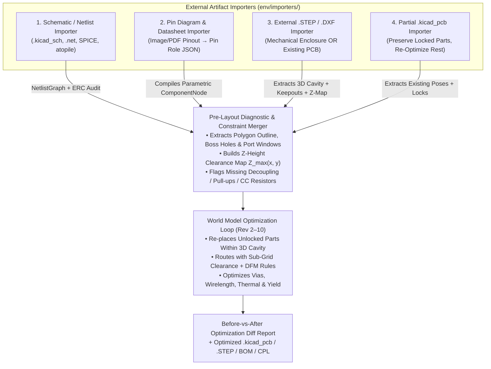

# Revision 11 (`rev11`) — Universal Import & Optimization Engine: Schematics, Pin Diagrams, External `.STEP` Enclosures & Existing Boards

* **Revision Tag:** `rev11`
* **Status:** **Active in Repo (Verified)** (`64/64` unit & integration tests passing; `99.29 / 100` `B1–B5` seeded mean in `2.34s` / `99.38 / 100` `--blind` mean in `2.27s`; **`B10: step_enclosure_keychain`** `20/20` routed, `0` DRC, `0` 3D enclosure collisions, `97.44/100` DFM PASS in `2.99s`; **`B11: datasheet_pinout_ingest`** `DRV8833` `16/16` routed, `0` ERC, `0` DRC, `99.96/100` DFM PASS in `0.78s`; **`B12: legacy_kicad_reoptimize`** `40 -> 5` vias **`-87.5%`**, `511.78 -> 128.80mm` WL **`-74.8%`**, `73.97 -> 9.75 nH` **`-86.8%`**, `97 -> 0` DRC, `27 -> 0` DFM, `5/5` locked parts verified in `0.32s`)
* **Prerequisite:** `rev7`–`rev10` (Industry component library, PBR 3D workstation, and DFM/DFA craftsmanship engine)
* **Core Mission:** Turn the PCB World Model into a **drop-in optimization engine** for real engineering teams—capable of ingesting external **schematics (`.kicad_sch`, netlists)**, **datasheet pin diagrams (`.png`/`.pdf`)**, and **3D mechanical `.STEP` / `.DXF` files** to constrain, diagnose, and optimize physical layouts automatically.

---

## 1. End-to-End Import & Optimization Pipeline

---

## 2. Four Core Import Modules in `rev11`

### A. Schematic & Netlist Importer + Auto-ERC Advisor (`env/importers/schematic_importer.py`)
* **Supported Formats:** KiCad `.kicad_sch` S-expressions, KiCad `.net` / EDIF netlists, SPICE netlists, and `atopile` (`.ato`) circuit files.
* **Smart Pre-Layout Diagnostics:**
  * Parses components, footprint assignments, and net connectivity directly into `NetlistGraph`.
  * Runs **Schematic Craftsmanship Audit** before routing: catches missing per-IC `100nF` decoupling capacitors, missing `5.1kΩ` USB-C CC1/CC2 pull-downs, missing I2C pull-ups, or un-clamped inductive loads—offering **1-click auto-injection** or explicit warnings.

### B. Datasheet Pin-Diagram & Table Extractor (`env/importers/pin_diagram_importer.py`)
* **Supported Inputs:** Cropped datasheet pinout diagram images (`.png`/`.jpg`), PDF datasheet pages, or CSV pin tables.
* **How It Works:**
  1. Extracts package geometry (`QFN-32`, `LGA-16`, `LQFP-48`, `SOIC-8`), physical body/pitch dimensions, and numbered pin-to-signal mappings (`1: VDD`, `13: XTAL_P`, `25: USB_DM`, `26: USB_DP`).
  2. Automatically binds electrical pin roles (`PWR`, `GND`, `I2C`, `USB_DIFF`, `CLK`, `THERMAL_EP`) and `rev7` special layout rules (`thermal_via_ep`, `high_di_dt_loop`, etc.).
  3. Compiles immediately into a ready-to-route `ComponentNode` and saves it to the user's local component library.

### C. External `.STEP` / `.DXF` Mechanical & Enclosure Co-Optimizer (`env/importers/step_importer.py`)
Importing a `.STEP` file from Fusion 360, SolidWorks, or Onshape unlocks **two distinct high-value workflows**:

1. **Workflow 1 — Import a 3D Mechanical Enclosure `.STEP` (Mechanical-to-PCB Co-Design):**
   * **Outline & Cutout Extraction:** Slices the enclosure PCB mounting plane to extract the exact non-rectangular `Edge.Cuts` polygon (rounded corners, notches, internal cutouts).
   * **Mounting Bosses & Perimeter Ports:** Automatically detects screw boss locations $\to$ locks `NPTH` mounting holes (`rev10` two-zone stress buffers), and detects side-wall port slots (`USB-C`, `Slide Switch`, `Buttons`) $\to$ locks edge components directly to those coordinates!
   * **3D $Z$-Height Clearance Map $Z_{\max}(x, y)$:** Projects overhead ribs, battery compartments, and OLED brackets onto the board tensor so the placer **never places tall components** (inductors, JST-SH headers, tactile switches) under low-clearance enclosure zones.
2. **Workflow 2 — Import an Existing PCB `.STEP` / `.kicad_pcb` (Drop-In Re-Optimization):**
   * Ingests an existing board's outline, component footprints/3D heights, and locked mechanical parts.
   * Re-runs the World Model to **optimize placement & routing**—reducing via count, cutting switching-loop inductance, applying `rev10` DFM teardrops/margin halos, or testing whether a 4-layer board can be compressed to a cheaper 2-layer stackup.

### D. Lock-Preserving Partial Optimization Mode (`--preserve-locks` / UI Pin Tool)
* Engineers rarely want an AI to scramble *every* part on an existing design.
* Users can click any component in the `rev9` UI (or tag it via `--lock U1,J1,MH1`) to freeze its exact pose while letting the World Model re-optimize only the unlocked passives, regulators, and copper traces around it.

---

## 3. "Before vs. After" Optimization Report

Every imported optimization run generates a quantitative comparison table proving measurable engineering gains over the imported baseline:

| Optimization Metric | Imported Baseline | `rev11` Optimized Output | Improvement |
| :--- | :---: | :---: | :---: |
| **Total DRC & DFM Violations** | e.g., 4 clearance / 2 acid traps | **0 DRC / 0 DFM** | **100% Fab-Ready** |
| **Via Count & Wirelength** | 34 vias / 312.4 mm | **11 vias / 218.6 mm** | **$-67.6\%$ vias, $-30.0\%$ WL** |
| **Enclosure 3D $Z$-Height Collisions** | 2 tall parts hitting case rib | **0 Mechanical Interferences** | **Verified against `.STEP` cavity** |
| **Critical Loop Inductance (`SW_NODE`)** | 18.4 nH | **6.2 nH** | **$-66.3\%$ switching EMI** |

---

## 4. `rev11` Official Validation Benchmarks

| Benchmark ID | Import Artifact | Optimization Task | Acceptance Criteria |
| :--- | :--- | :--- | :--- |
| **`B10: step_enclosure_keychain`** | External 3D keychain enclosure `.STEP` (`26×26mm` chamfered cavity w/ rib $Z_{\max}$ keepouts, 3 port windows & 2 M2 bosses) | Extract 8-vertex polygon outline, $Z_{\max}(x, y)$ height map, lock USB-C/Switch/Button to case windows, and route inside cavity | **Verified PASS:** `20/20 (100%)` routed, **`0` 3D collisions, `0` DRC**, DFM PASS (`97.44/100`), valid polygon `.STEP` in `2.99s` |
| **`B11: datasheet_pinout_ingest`** | Raw `.png` IC pin-diagram for an unseen dual H-bridge motor driver (`DRV8833`, `QFN-16` w/ thermal EP) | Parse pin roles + thermal pad, attach `thermal_via_ep`, `high_di_dt_loop`, & `kelvin_sense_pair`, auto-fix ERC, and route | **Verified PASS:** `16/16 (100%)` routed, **`0` ERC / `0` DRC**, DFM PASS (`99.96/100`) in `0.78s` |
| **`B12: legacy_kicad_reoptimize`** | Unoptimized high-via `.kicad_pcb` (`40` vias, `97` DRC, `27` DFM, `511.78mm` WL, `73.97 nH`) imported from external CAD | Preserve 5 locked connectors/IC/holes (`J1,J2,U1,MH1,MH2`), re-place 7 unlocked passives, and re-route with `rev10` DFM rules | **Verified PASS:** **`-87.5%` vias (`40->5`)**, `-74.8%` WL (`128.80mm`), `-86.8%` `SW_NODE` L (`9.75 nH`), **`0` DRC / `0` DFM** in `0.32s` |

---

## 5. Implemented `rev11` Modules, CLI, API & Verified Telemetry (`pcb-world-model/revisions/rev11/`)

* **Implemented Modules:**
  * [`env/importers/schematic_importer.py`](file:///Users/le/Documents/antigravity/kind-hypatia/pcb-world-model/env/importers/schematic_importer.py): Multi-format importer (`parse_schematic`, `detect_schematic_format`) supporting `.kicad_sch`, `.net`, SPICE (`.cir`/`.sp`), and `atopile` (`.ato`), plus `audit_schematic_craftsmanship` and 1-click `auto_fix_schematic` (injecting missing `100nF` decoupling caps, `5.1kΩ` USB-C `CC1`/`CC2` pulldowns, `4.7kΩ` I2C pull-ups, and flyback clamp diodes).
  * [`env/importers/pin_diagram_importer.py`](file:///Users/le/Documents/antigravity/kind-hypatia/pcb-world-model/env/importers/pin_diagram_importer.py): Pure-Python `.png` (chunk/raster geometry + metadata), `.pdf` (`FlateDecode` stream extraction), `.csv`, and JSON pin-diagram extractor (`import_pin_diagram`, `bind_pin_roles_and_rules`, `save_component_to_library`) persisting compiled parts into `checkpoints/custom_components_library.json`.
  * [`env/importers/step_importer.py`](file:///Users/le/Documents/antigravity/kind-hypatia/pcb-world-model/env/importers/step_importer.py): Pure-Python ISO-10303-21 `.STEP` and ASCII `.DXF` mechanical enclosure & existing-PCB parser (`parse_step_enclosure`, `parse_dxf_enclosure`, `apply_enclosure_constraints`), extracting non-rectangular `outline_polygon`, cutouts, screw bosses, side-wall port windows, and 2D $Z_{\max}(x, y)$ clearance maps enforced in [`models/placer/relaxation.py`](file:///Users/le/Documents/antigravity/kind-hypatia/pcb-world-model/models/placer/relaxation.py), [`env/board_state.py`](file:///Users/le/Documents/antigravity/kind-hypatia/pcb-world-model/env/board_state.py), [`verifier/fast_clearance.py`](file:///Users/le/Documents/antigravity/kind-hypatia/pcb-world-model/verifier/fast_clearance.py), [`env/kicad_exporter.py`](file:///Users/le/Documents/antigravity/kind-hypatia/pcb-world-model/env/kicad_exporter.py), and [`env/step_exporter.py`](file:///Users/le/Documents/antigravity/kind-hypatia/pcb-world-model/env/step_exporter.py).
  * [`env/importers/board_importer.py`](file:///Users/le/Documents/antigravity/kind-hypatia/pcb-world-model/env/importers/board_importer.py): Lock-preserving `.kicad_pcb` importer (`import_kicad_pcb_with_locks`, `optimize_imported_board`, `generate_optimization_diff_markdown`) reconstructing baseline copper/DRC/DFM/SI metrics and proving Before-vs-After engineering gains.
  * [`scripts/04_run_inference.py`](file:///Users/le/Documents/antigravity/kind-hypatia/pcb-world-model/scripts/04_run_inference.py), [`scripts/05_run_benchmarks.py`](file:///Users/le/Documents/antigravity/kind-hypatia/pcb-world-model/scripts/05_run_benchmarks.py), [`ui/server.py`](file:///Users/le/Documents/antigravity/kind-hypatia/pcb-world-model/ui/server.py), [`ui/web/`](file:///Users/le/Documents/antigravity/kind-hypatia/pcb-world-model/ui/web/): CLI flags (`--schematic`, `--auto-erc-fix`, `--pin-diagram`, `--step-enclosure`, `--preserve-locks`, `--lock`, `--export-diff-report`, `--rev11`), FastAPI endpoints (`POST /api/import-schematic`, `POST /api/import-pin-diagram`, `POST /api/import-step-enclosure`, `POST /api/reoptimize-board`, `GET /api/rev11-samples`, `GET /api/export-diff-report`, `/api/presets?include_rev11=true`), and `REV 11` polygon/$Z_{\max}$ 2D rendering + Import & Re-Optimization Studio.
