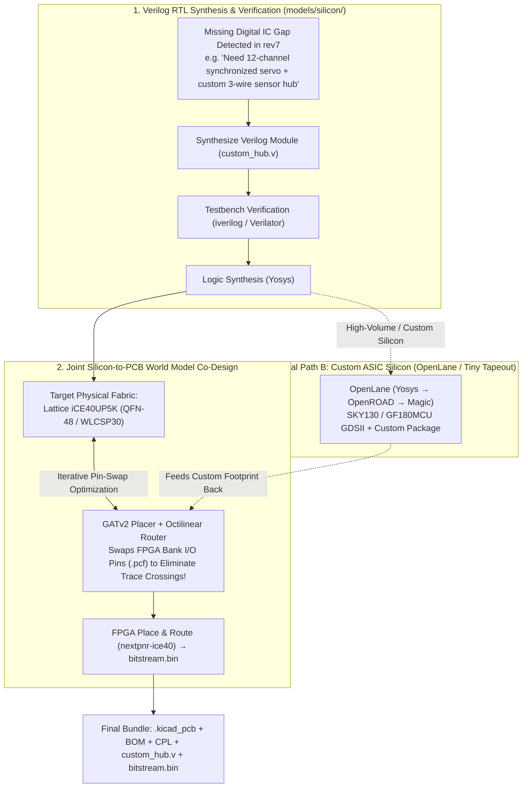

# Revision 8 (`rev8`) — Silicon-to-Board Co-Design: Verilog RTL Synthesis, FPGA Pin-Swap Optimization & Open-Source ASIC Flow

* **Revision Tag:** `rev8`
* **Status:** **Active in Repo (Verified)** (`52/52` unit & integration tests passing; `99.56 / 100` `B1–B5` mean score in `1.72s`; `B9` `iverilog+vvp` `PASS` (`5` checks) + `verilator` `PASS`, `147 -> 11` crossings (`-92.5%`), `46/46` routed, `0` ERC / `0` DRC, `SI=PASS`)
* **Prerequisite:** `rev7` verified (`46/46` tests, `99.56 / 100`)
* **Core Mission:** Extend the World Model **inside the silicon boundary itself**—when an off-the-shelf digital IC does not exist or cannot meet custom timing/interface specs, synthesize custom **Verilog-2001 RTL** onto an on-board **FPGA/CPLD** (with joint `.pcf` PCB-pin-swap optimization) or an **open-source ASIC (`GDSII`)** flow.

---

## 1. Engineering Manager Assessment: Where Verilog Works vs. Physical Boundaries

Using Verilog to synthesize missing components is a **genuinely high-leverage breakthrough**, provided we separate what Verilog can physically build from what requires discrete analog silicon:

| Domain | Can Verilog Synthesize It? | Physical Target on the PCB |
| :--- | :---: | :--- |
| **Custom Digital ICs, Bus Bridges, Timing & DSP** *(e.g. multi-channel PWM, WS2812/HUB75 display controllers, SPI-to-I2S bridges, hardware safety interlocks, custom encoders, RISC-V soft-cores)* | **YES** | Synthesized via **Yosys + `nextpnr`** onto a tiny on-board **FPGA/CPLD** (e.g., Lattice `iCE40UP5K`, Gowin `GW1N`, or `RP2040 PIO`) — **or** compiled to `GDSII` silicon via **OpenLane (`SKY130`)**. |
| **Analog, Power & Physical MEMS Sensors** *(e.g. LiPo chargers, LDOs, buck converters, MEMS accelerometers, optical sensors)* | **NO (Physics Limit)** | Pure Verilog describes discrete clocked logic, not continuous current/voltage/MEMS physics. These remain **discrete analog/mixed-signal ICs** from `rev7`'s catalog (optionally modeled behaviorally in **Verilog-AMS** for full-board co-simulation). |

---

## 2. The Killer Breakthrough: Joint Silicon-Pin + PCB-Layout Co-Design

Normally, PCB routing treats IC pins as **immovable fixed anchors**. With an FPGA/CPLD target in `rev8`, the World Model controls **both the Verilog pin constraint file (`.pcf`) and the PCB traces simultaneously**:



### Why Joint Pin-Swapping Beats Human & LLM Designers:
* Suppose `U1` (FPGA) needs to connect 16 bus lines to `J1` (Connector) and `U2` (Display).
* A human often locks FPGA pins arbitrarily, causing a spiderweb of 15 vias and crossed traces on the PCB.
* Because `rev8` treats the FPGA’s I/O bank mapping (`.pcf`) as a **learnable/optimizable permutation vector**, the Placer/Router swaps FPGA pin assignments in real time so signals fan out in **planar, zero-crossing order—cutting vias near zero**.

---

## 3. Two Fabrication Targets in `rev8`

### Target A: Instant Programmable Silicon (`FPGA / CPLD` — Prototype & Production Ready)
* **Supported Physical Devices:** `Lattice iCE40UP5K` (`SG48` QFN-48 or `UWG30` 2.15×2.55mm WLCSP), `Lattice MachXO2/XO3`, `Gowin GW1NR-9`, `RP2040 PIO` coprocessor.
* **Open-Source Toolchain:** `iverilog` / `Verilator` (simulation) $\to$ `Yosys` (RTL synthesis) $\to$ `nextpnr` (FPGA place & route) $\to$ `icepack` (bitstream generation).
* **Output Artifacts:** In addition to `.kicad_pcb`, `bom.csv`, and `positions.csv`, `rev8` outputs `rtl/custom_module.v`, `constraints/pins.pcf`, and `firmware/bitstream.bin`.

### Target B: Custom Monolithic ASIC (`OpenLane / SKY130` — Deep Silicon Mode)
* **Target Process:** SkyWater `SKY130` ($130\text{nm}$) or GlobalFoundries `GF180MCU` ($180\text{nm}$), compatible with **Tiny Tapeout** and **Efabless MPW** shuttles.
* **Flow:** `custom_module.v` $\to$ `OpenLane` (`Yosys` $\to$ `OpenROAD` floorplan/CTS/routing $\to$ `Magic` DRC/LVS) $\to$ `custom_ic.gds` + custom QFN/DIP pinout JSON injected straight into `rev7`'s footprint synthesizer.

---

## 4. Implemented `rev8` Modules, API, & Verified Benchmark Results

* **Implemented Modules:**
  * [`models/silicon/verilog_composer.py`](file:///Users/le/Documents/antigravity/kind-hypatia/pcb-world-model/models/silicon/verilog_composer.py): Synthesizes Verilog-2001 modules + self-checking testbenches (`quad_ws2812_spi`, `multi_pwm_controller`, `spi_i2s_bridge`, `safety_interlock`), enforces the digital vs. analog/MEMS physics boundary (`assess_silicon_feasibility`), and executes real `iverilog` + `vvp` simulation and `verilator --lint-only -Wall` checks.
  * [`models/silicon/fpga_codesign.py`](file:///Users/le/Documents/antigravity/kind-hypatia/pcb-world-model/models/silicon/fpga_codesign.py): Runs Yosys/`nextpnr-ice40`/`icepack` (when installed) or the built-in iCE40UP5K/GW1NR-9/MachXO2/RP2040-PIO technology mapper & bitstream emitter (`7E AA 99 7E` preamble), and optimizes `.pcf` I/O pin permutations + FPGA rotation jointly against destination pad geometry to eliminate rat's-nest crossings.
  * [`models/silicon/asic_openlane.py`](file:///Users/le/Documents/antigravity/kind-hypatia/pcb-world-model/models/silicon/asic_openlane.py): OpenLane `SKY130`/`GF180MCU` wrapper generating `config.json`, valid Calma binary `GDSII` streams (`.gds`), and Class C QFN package pinouts compiled via `compile_datasheet_pin_table()`.
  * Integrated into `env/sexpr_parser.py` (`fpga_custom_protocol_bridge`), `models/composer/schematic_composer.py`, `models/composer/constraint_negotiator.py`, `env/manufacturing_exporter.py`, `scripts/04_run_inference.py`, `ui/server.py` (`/api/silicon/synthesize`, `/api/silicon/codesign`, `/api/export-silicon`), and the **REV 8 Web UI (`Silicon & RTL` workbench)**.

### Verified `rev8` Benchmark Results (`pcb-world-model/revisions/rev8/`)

| Benchmark | Result | Routed Nets | DRC Errors | Key Metrics & Verified Behavior |
| :--- | :---: | :---: | :---: | :--- |
| **`B1–B5` Suite (Seeded)** | **PASS** | **44 / 44 (100%)** | **0** | Mean score **`99.56 / 100`**, `10` vias, **`1.72s`** total (`benchmark_report.json`). |
| **`B1–B5` Suite (`--blind`)** | **PASS** | **44 / 44 (100%)** | **0** | Mean score **`99.29 / 100`**, `16` vias, **`1.77s`** total (`benchmark_report_blind.json`). |
| **`B9: fpga_custom_protocol_bridge` (Baseline `--no-pin-swap`)** | **FAIL (42/46)** | `42 / 46 (91.3%)` | `0` | Unoptimized `.pcf` has **`147` wire crossings**, `1209.18mm` WL, `131` vias, `199.90 mOhm`, `11.35s`. |
| **`B9: fpga_custom_protocol_bridge` (`rev8` Joint `.pcf` Co-Design)** | **PASS** | **46 / 46 (100%)** | **0** | `quad_ws2812_spi.v` passes `iverilog+vvp` (`5/5` checks) & `verilator` (`0` warns); `.pcf` swap cuts crossings **`147 -> 11 (-92.5%)`**, `29` pins swapped, `Fmax=80.03MHz`; `993.61mm` WL (`-17.8%`), `85` vias (`-35.1%`), `106.79 mOhm`, `SI=PASS`, **`4.29s`** + `fab_bundle_b9/` (`rtl/`, `.pcf`, `.bin`, `.gds`). |

### Key Commands
```bash
# Run all 52 rev1–rev8 tests (includes real iverilog + Verilator + FastAPI silicon tests)
uv run pytest pcb-world-model/tests -v

# Run B9 FPGA + Verilog + .pcf pin-swap + SKY130 GDSII co-design and export full bundle
uv run python pcb-world-model/scripts/04_run_inference.py \
  --board fpga_custom_protocol_bridge \
  --include-asic \
  --export-fab-dir /tmp/fab_b9
```
