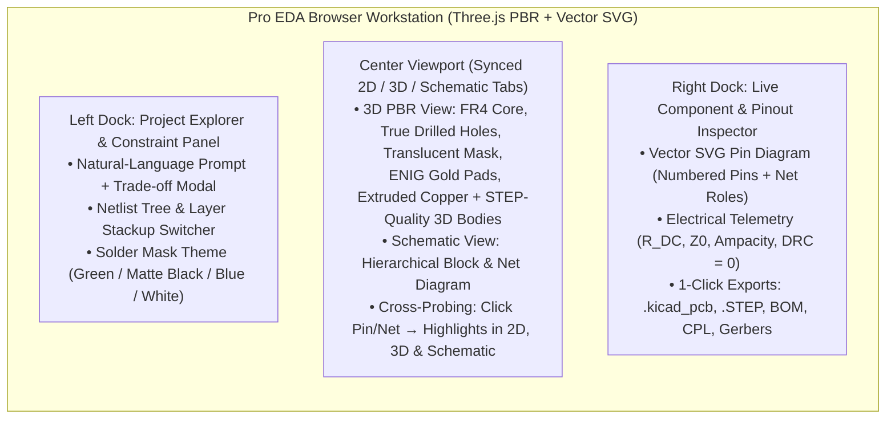

# Revision 9 (`rev9`) — Pro EDA Workstation UI/UX: Real-Time PBR 3D Renders, Schematic Cross-Probing, Pin Diagrams & `.STEP` Assembly Export

* **Revision Tag:** `rev9`
* **Status:** **Active in Repo (Verified)** (`55/55` unit & integration tests passing; `99.56 / 100` `B1–B5` seeded mean in `1.75s` / `99.29 / 100` `--blind` mean in `1.76s`; browser-verified 3D PBR + Matte Black mask + Flip Board + Schematic cross-probe + LGA-16 SVG Pin Diagram with `0` console/network errors; AP214 `.STEP` export validated at `0` dangling refs across `2L`/`4L` boards)
* **Prerequisite:** `rev5` Web Console (`ui/server.py`, `ui/web/`) + `rev7` Component Metadata + `rev8` Silicon Workbench
* **Core Mission:** Upgrade the browser interface from basic 2D/3D polygon shapes into an **Altium Designer / KiCad 3D-caliber interactive EDA workstation** featuring physically based (PBR) solder mask & ENIG gold rendering, procedural STEP-quality 3D component bodies, interactive IC pin diagrams, cross-probed schematics, and true 3D `.STEP` mechanical export.

---

## 1. Visual & UX Architecture (`ui/web/` + 3D Rendering Engine)

---

## 2. Five Pillars of `rev9` UI/UX Upgrades

### Pillar 1: Real-Time PBR PCB Substrate & True Mechanical Cutouts
Replace flat colored rectangles with physically based **WebGL2 / Three.js `MeshPhysicalMaterial`** layers that respond to studio HDRI environment lighting in real time:
1. **True Drilled Substrate (`ExtrudeGeometry` with Holes):**
   * Board outline and `2.0mm` corner `NPTH` mounting holes / vias are extruded from `0.8mm` or `1.6mm` woven FR4 material (`#9aa37a` translucent fiberglass edge) so you literally see through mounting holes.
2. **Translucent Solder Mask + Underlying Copper Relief:**
   * Selectable production mask finishes (**Matte Black**, **KiCad Classic Green**, **Royal Blue**, **Crimson Red**, **Arctic White**) using `MeshPhysicalMaterial` (`clearcoat: 0.45, roughness: 0.32`).
   * Copper ground pours (`B.Cu`) and routed traces sit beneath the solder mask so traces cast realistic subtle raised copper relief under the mask finish.
3. **ENIG Immersion Gold Pads & High-DPI Silkscreen:**
   * Exposed pads and plated barrel rings render with metallic ENIG gold (`metalness: 0.92, roughness: 0.18, color: #e2b857`).
   * Dynamic Canvas2D silkscreen texture renders crisp `F.SilkS` / `B.SilkS` reference designators (`U1`, `R1`, `C2`), Pin-1 chamfer dots, diode polarity bars, and edge labels (`BOOT`, `RST`, `ON/OFF`).

### Pillar 2: Procedural "STEP-Quality" 3D Component Library (`ui/web/component_meshes_3d.js`)
Every package family from `rev7` renders as a multi-material, chamfered 3D assembly in real time (zero external multi-megabyte `.step` downloads needed in-browser):

| Package Family | Real-Time 3D Procedural Geometry & Materials |
| :--- | :--- |
| **`QFN` / `LGA` / `SOIC` / `SOT-23`** | Dark epoxy mold body with chamfered top bevel, silver/tinned gull-wing leads or perimeter lands, laser-etched Pin-1 dimple & IC part text (`ESP32-C3FN4`, `LIS3DH`). |
| **`RF Module` (`ESP32-C3-MINI-1`)** | Brushed nickel EMI shield can (`metalness: 0.88`) mounted on dark substrate overhang with visible gold meandering PCB trace antenna. |
| **`0402`–`1206` Passives & LEDs** | Ceramic tan MLCC capacitors with silver end-caps; black resistor bodies with printed SMD EIA code (`512`, `472`, `103`); translucent epoxy LED domes with subtle emissive status glow. |
| **`USB-C` / `JST-SH` / `Headers`** | Brushed stainless-steel USB-C shell with recessed black tongue and gold contact pins; molded cream JST-SH housing; gold-plated header pins. |
| **`Slide Switch` / `Tactile Buttons`** | Metal-framed SPDT switch with sliding actuator nub; micro-button with brass dome cap and edge-accessible plunger. |

### Pillar 3: Interactive Vector Pin Diagrams & Component Inspector (`ui/web/pin_diagram.js`)
Clicking any IC, sensor, or connector (`U1`, `J1`, `U2`) renders a crisp, Altium/datasheet-style **interactive SVG Pinout Diagram** in the right inspector panel:
* Draws the exact physical package view (QFN-32 4-sided, LGA-16, SOT-23-5, USB-C) with Pin-1 marker.
* Labels every pin number, electrical signal name (`GPIO9 / BOOT`, `CC1`, `I2C_SDA`, `INT1`), and color-coded role badge (**Red** = Power, **Black/Gray** = GND, **Teal** = I2C/SPI, **Blue** = USB Diff-Pair, **Amber** = Wake/GPIO).
* Clicking any pin on the SVG diagram highlights the entire routed copper net across the 3D board and schematic.

### Pillar 4: Auto-Generated Schematic View & Cross-Probing
Add a **Schematic** tab alongside **2D CAD** and **3D PBR** that renders a clean orthogonal circuit diagram grouped by functional block (Power Input & Charger, 3.3V Regulation, MCU Core & Crystal, Sensor/Display I2C Bus):
* **Live Cross-Probing:** Selecting `R1 (5.1kΩ)` or net `USB_DP` in the Schematic immediately dims non-selected nets in the 3D PCB viewport and zooms/highlights the selected pads and traces.
* **Flip-Board & Cutaway Inspection (`F` Key / Top-Bottom Toggle):** Smoothly animates flipping the board $180^\circ$ to inspect the `B.Cu` ground pour and verify rear flatness (e.g., checking that the `26×26mm` keychain back side has only flat gold LiPo pads).

### Pillar 5: True 3D `.STEP` Mechanical Assembly Export (`env/step_exporter.py`)
* Alongside `.kicad_pcb`, `bom.csv`, and `positions.csv`, export a true ISO-10303-21 **`.step` 3D CAD assembly** (board substrate + drilled mounting holes + 3D component bounding/package solids) via `CadQuery` / `OCP` (or lightweight AP214 STEP writer) so mechanical engineers can import the PCB directly into Fusion 360, SolidWorks, or Onshape to verify 3D-printed enclosure fit.

---

## 3. Target Acceptance Criteria for `rev9`

| Metric / Feature | `rev5` Current UI | `rev9` Target Experience |
| :--- | :---: | :--- |
| **3D Viewport Fidelity** | Simple geometric boxes/polygons | **PBR FR4 + Translucent Solder Mask + ENIG Gold + Chamfered 3D Packages + True Drilled Holes** |
| **Component & Pin Inspection** | JSON summary text only | **Interactive Vector SVG Pinout Diagrams + Color-Coded Pin Roles** |
| **Schematic & Cross-Probing** | None | **Tabbed Hierarchical Schematic View synced with 2D & 3D selection** |
| **Mechanical CAD Export** | `.kicad_pcb`, `bom.csv`, `positions.csv` | **Adds true `.step` 3D assembly export for enclosure co-design** |
| **Interactive Frame Rate** | 60 FPS | **60 FPS real-time orbit, flip, layer-toggle & live rollout streaming** |

---

## 4. Implemented `rev9` Modules, API, & Verified Benchmark Results

* **Implemented Modules:**
  * [`env/step_exporter.py`](file:///Users/le/Documents/antigravity/kind-hypatia/pcb-world-model/env/step_exporter.py): Built-in pure-Python ISO-10303-21 AP214 (`AUTOMOTIVE_DESIGN`) 3D CAD assembly exporter (`generate_step_assembly`, `export_step_assembly`, `validate_step_structure`) emitting drilled FR4 `MANIFOLD_SOLID_BREP` substrates with `CYLINDRICAL_SURFACE` NPTH/THT holes, placed top/bottom 3D component solids, and `COLOUR_RGB` solder mask / material styles.
  * [`env/board_state.py`](file:///Users/le/Documents/antigravity/kind-hypatia/pcb-world-model/env/board_state.py), [`env/manufacturing_exporter.py`](file:///Users/le/Documents/antigravity/kind-hypatia/pcb-world-model/env/manufacturing_exporter.py), [`scripts/04_run_inference.py`](file:///Users/le/Documents/antigravity/kind-hypatia/pcb-world-model/scripts/04_run_inference.py), [`ui/server.py`](file:///Users/le/Documents/antigravity/kind-hypatia/pcb-world-model/ui/server.py): Enriched `to_summary_dict()` with component `footprint`/`body_*` metadata and full `nets` connectivity; wired `.step` export into `export_manufacturing_bundle()`, `--export-step`, `GET /api/export-step`, and `GET /api/manufacturing_bundle`.
  * [`ui/web/pcb_pbr_3d.js`](file:///Users/le/Documents/antigravity/kind-hypatia/pcb-world-model/ui/web/pcb_pbr_3d.js) & [`ui/web/component_meshes_3d.js`](file:///Users/le/Documents/antigravity/kind-hypatia/pcb-world-model/ui/web/component_meshes_3d.js): Three.js WebGL2 PBR renderer (`RoomEnvironment` studio HDRI, woven FR4 `ExtrudeGeometry` with real drilled holes, 5 translucent `MeshPhysicalMaterial` solder mask finishes, ENIG gold pads, Canvas2D `F.SilkS`/`B.SilkS`, procedural STEP-quality 3D bodies, `180°` Flip-Board (`F`), and click raycasting).
  * [`ui/web/pin_diagram.js`](file:///Users/le/Documents/antigravity/kind-hypatia/pcb-world-model/ui/web/pin_diagram.js) & [`ui/web/schematic_view.js`](file:///Users/le/Documents/antigravity/kind-hypatia/pcb-world-model/ui/web/schematic_view.js): Interactive Vector SVG Pinout Diagrams with color-coded role badges and Auto-Generated Functional-Block Schematic synced via live cross-probing across 2D CAD, 3D PBR, Project Explorer, and Pin Inspector.

### Verified `rev9` Benchmark & `.STEP` CAD Results (`pcb-world-model/revisions/rev9/`)

| Benchmark / Board | Result | Routed Nets | DRC | Key `rev9` Metrics |
| :--- | :---: | :---: | :---: | :--- |
| **`B1–B5` Suite (Seeded)** | **PASS** | **44 / 44 (100%)** | **0** | Mean score **`99.56 / 100`**, `10` vias, **`1.75s`** total (`benchmark_report.json`). |
| **`B1–B5` Suite (`--blind`)** | **PASS** | **44 / 44 (100%)** | **0** | Mean score **`99.29 / 100`**, `16` vias, **`1.76s`** total (`benchmark_report_blind.json`). |
| **`mcu_sensor_node` (.STEP)** | **PASS** | `8 / 8` | `0` | `0.52s` rollout; `.step` export **`1.17ms`** (`116.7 KB`, `11` solids, `6` holes, `0` dangling refs). |
| **`B6: wearable_oled_keychain_26x26` (.STEP)** | **PASS** | `20 / 20` | `0` | `2.11s` rollout; `.step` export **`2.23ms`** (`277.4 KB`, `28` solids, `2` NPTH holes, `0` dangling refs). |
| **`flight_controller_50` (4L .STEP)** | **PASS** | `43 / 43` | `0` | `3.25s` rollout; `.step` export **`4.33ms`** (`543.5 KB`, `51` solids, `23` holes, `0` dangling refs). |
| **`B9: fpga_custom_protocol_bridge` (4L .STEP)** | **PASS** | `46 / 46` | `0` | `3.91s` rollout; `.step` export **`2.66ms`** (`299.9 KB`, `25` solids, `34` holes, `0` dangling refs). |
| **Live Browser Workstation (`1440x900` & `390x844`)** | **PASS** | `20 / 20` (`B6`) | `0` | `0` console/network errors; verified 3D PBR (`Matte Black`), `Flip (F)`, Schematic & `U4 LIS3DH` LGA-16 SVG cross-probe. |
